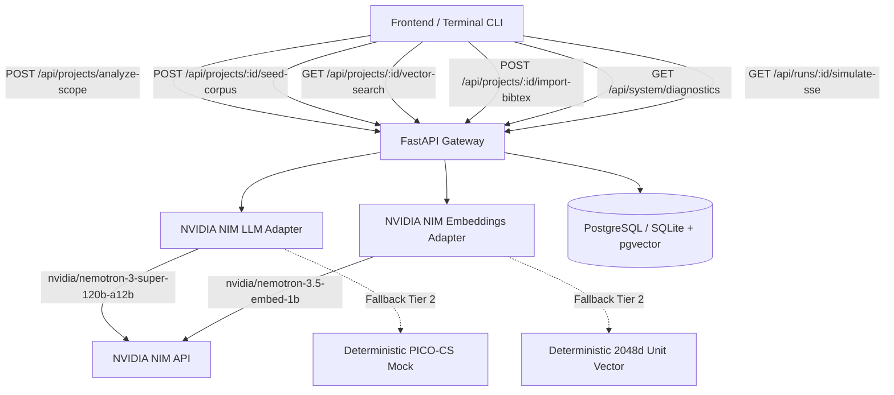

# ResearchPilot Architecture — Week 1 Foundation

## Overview
ResearchPilot Phase 1 establishes the foundational vertical slice that scopes raw research inquiries, indexes a gold-standard 25-paper benchmark corpus, executes 2,048-dimensional vector search using cosine similarity, checks provider diagnostics across scholarly APIs and NVIDIA NIM models, and demonstrates an animated nine-agent handoff pipeline over Server-Sent Events (SSE).

---

## 1. Core Technological Choices

| Component | Technology | Role & Specification |
| :--- | :--- | :--- |
| **Backend Framework** | FastAPI + Pydantic v2 | High-throughput async endpoints, contract validation, strict schema conformance. |
| **Database** | PostgreSQL 16 + pgvector (or SQLite fallback) | Persistence of projects, paper metadata, 2048d embeddings, import audits. |
| **Embeddings Model** | `nvidia/nemotron-3.5-embed-1b` | 2,048-dimensional embeddings, passage input mode for corpus, query input mode for search. |
| **LLM Model** | `nvidia/nemotron-3-super-120b-a12b` | Agent reasoning, PICO-CS topic scope decomposition, Boolean query generation. |
| **Streaming** | Server-Sent Events (SSE) | Live streaming of 9-stage pipeline handoff envelopes (`TaskEnvelope`). |
| **Testing** | pytest + pytest-asyncio | Full unit, contract, idempotency, and retrieval evaluation suite. |

---

## 2. 9-Agent Pipeline Architecture (Phase 1 Simulation)

The pipeline handoff sequence is defined through versioned `TaskEnvelope` events containing `run_id`, `correlation_id`, `task_id`, `stage`, `status`, `payload`, and `simulation_mode=True`:

1. **Stage 1: Topic Scope Analyzer** — Decomposes raw topic into PICO-CS and generates 3 research questions.
2. **Stage 2: Literature Harvester** — Runs Boolean queries across OpenAlex, arXiv, and CrossRef.
3. **Stage 3: Evidence & Claim Extractor** — Extracts section-aware quotes and accuracy degradation percentages.
4. **Stage 4: Method & Dataset Profiler** — Catalogs algorithms, datasets, and baseline splits.
5. **Stage 5: Research Gap Reasoner** — Formulates candidate gaps and detects covariate shift issues.
6. **Stage 6: Ontology & Knowledge Graph Builder** — Builds relational knowledge graph nodes and edges.
7. **Stage 7: Experiment Synthesizer** — Defines hypothesis, baseline protocols, and validation metrics.
8. **Stage 8: Verification & Audit Specialist** — Audits data leakage and verifies time-aware splits.
9. **Stage 9: Meta-Reviewer & Report Generator** — Produces comprehensive research blueprint synthesis.
